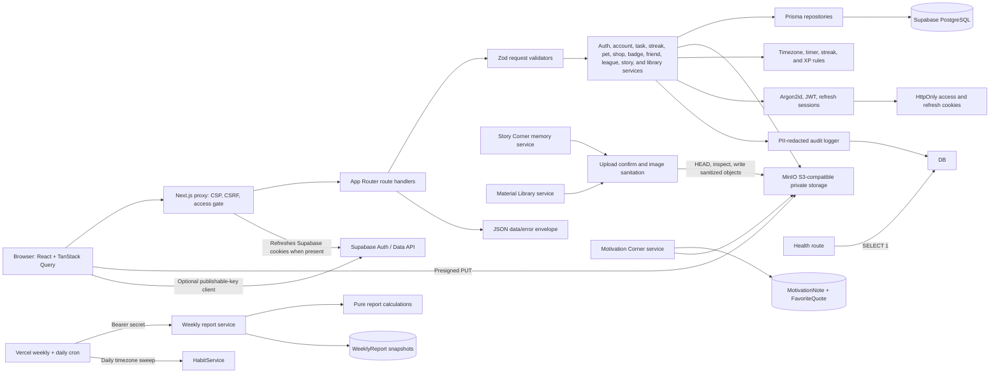

# Architecture

## Request and identity flow

API request flow is route handler -> Zod validator -> service -> repository. The Next.js proxy checks access JWTs before protected APIs and application pages; API handlers re-check the live session in PostgreSQL. The browser rotates the refresh token every 12 minutes while the app is active and also refreshes after a 401. Every API response is `{ data }` or `{ error: { code, message } }`.

The source tree separates browser presentation (`src/frontend`) from server application code (`src/backend`). `src/shared` is limited to isomorphic utilities imported by both sides. Next.js owns the route boundary: page/layout and API entrypoint files stay under `src/app`, where they compose frontend components or delegate API work to backend services. Client components must never import from `src/backend`.

## Modules

- `src/app`: Next.js-required route boundary for the public landing page, auth pages, public `/design-system` showcase, onboarding/app pages, accessible loading/404/error boundaries, `/api/health`, and `/api/v1` API entrypoints. Page files compose frontend components; API handlers delegate to backend validators and services.
- `src/frontend/components/auth`: signup and login form UI.
- `src/frontend/components/landing`: animated public landing page.
- `src/frontend/components/providers`: TanStack Query, current-user query, and authenticated app guard.
- `src/frontend/components/providers/MotionProvider.tsx`: reduced-motion orchestration, adaptive HIGH/MID/LOW tier selection, and shared `LazyMotion` setup; animated components use `m.*` primitives.
- `src/frontend/components/providers/PerfHud.tsx`: development-only FPS, motion-tier, and long-task overlay (toggle with Shift+P).
- `src/frontend/components/fx`: pointer-only tilt and spotlight surfaces plus one-time reveal-on-scroll primitive.
- `src/frontend/components/layout`: responsive shell, route transitions, and logout control.
- `src/frontend/components/layout/HeaderStats.tsx`: persisted streak, XP, gems, hearts, and daily progress widgets.
- `src/frontend/components/dashboard`: timezone-aware calendar, task sheet, persisted focus timer controls, and reward interactions.
- `src/frontend/components/reports`: timezone-aware weekly report dashboard, accessible Recharts visualizations, friend/badge panels, and private-data-free PNG export.
- `src/frontend/components/motivation`: accessible freeform board with sticky notes, themed papers, drag/resize/rotate handles, favorites, and list view.
- `src/frontend/components/story`: Story Corner feed, memory editor, upload picker with drag/drop and camera capture, progress/cancel/retry controls, and client-side video posters.
- `src/frontend/components/materials`: grid/list/timeline library views, nested subject tree, sanitized note editor with local drafts, detail reader, and restricted document upload controls.
- `src/frontend/components/ui`: accessible reusable controls.
- `src/frontend/components/game`: shop, achievements, preferences, and sound controls.
- `src/frontend/components/settings`: profile/timezone/daily-goal editing, JSON export, and password-confirmed account deletion.
- `src/frontend/components/pets`: five original animated SVG companions, global reaction widget, and pet customization.
- `src/backend/validators`: backend-facing validator exports and request parsing wrapper, including report, memory, material, folder, and upload declarations. Client/server schemas shared by both layers are defined under `src/shared/validators`.
- `src/backend/services`: signup, login, session rotation, account, export, deletion, profile, daily task, date-lock, streak, pet, shop, badge, notification, friend invite/block/nudge, duo-streak, shared-goal, weekly-league, weekly report generation, Motivation Corner note/quote management, Story Corner, Material Library, folder, and secure storage use cases.
- `src/backend/repositories`: Prisma persistence for users, sessions, profiles, audit records, tasks, day logs, XP/streak stats, pets, preferences, shop inventory, achievements, notifications, friendship invitations/links/blocks, duo streaks, shared goals/progress, league and report snapshots, motivation notes/favorite quotes, memories, materials, nested folders, pending uploads, and owned stored files.
- `src/backend/middleware`: `requireUser` and ownership checks.
- `src/backend/lib`: validated environment, cookies, CSRF, passwords, token operations, rate limits, API envelopes, audit logging, report cron authorization, storage MIME/URL policy, S3 client, and pure timezone/streak/XP/report math.
- `src/frontend/lib`: browser API client, theme, sound, animation, general utilities, and quote list.
- `src/frontend/lib/motion`: shared motion durations, easing curves, spring settings, and reusable animation variants.
- `src/shared/sanitization`: DOMPurify note sanitizer shared by the Material Library UI and backend validation path.
- `src/shared/motivation`: pure board geometry and z-order helpers shared by the board UI and backend service.
- `src/shared/validators`: isomorphic Zod schemas used by frontend forms and backend request validation.
- `src/shared/game`: pure XP and level calculations shared by the dashboard and backend services.
- `docs/aurora-audit.md`: page/component visual coverage and known animation/performance gaps; `docs/perf-baseline.md`, `docs/perf-after.md`: bundle inventory and honest browser-metric collection status.
- `src/frontend/utils/supabase`: optional Supabase SSR browser/server clients and cookie refresh adapter; HabitHop authentication and Prisma repositories remain the primary app path.
- `proxy.ts`: CSP, security headers, CSRF checks, HabitHop access-cookie gate, and optional Supabase Auth cookie refresh.
- `prisma`: PostgreSQL models for identity and session security, tasks/day logs/stats, pet inventory, preferences, achievements, notifications, friendships, weekly leagues/reports, motivation notes/favorite quotes, memories, materials, folders, pending uploads, and stored media.
- `prisma/migrations`: Prisma Migrate baseline and incremental schema changes. The existing Supabase database is baselined; `npm run db:migrate:deploy` applies reviewed changes in release and CI environments.
- `tests/unit`, `tests/integration`, `tests/e2e`: auth/security, streak/date/XP, badge, report math/cron auth, board geometry/z-order/write limits, MIME sniffing, upload policy, URL, and note sanitizer unit tests; database-backed task, report and motivation ownership/limits, memory/file/material ownership, cascading folder, and transactional shop tests; Playwright dashboard, Story Corner, Material Library, weekly report, and Motivation Corner flows.
- `public`: static assets. Do not add unlicensed or copyrighted artwork.
- Root deployment files: `Dockerfile` builds a Next standalone image with an HTTP healthcheck; `DEPLOYMENT.md` documents managed and VPS deployment, environment, cron, and backup operations.
- `scripts/prepare-standalone.mjs` copies static CSS/JS/fonts and public files into standalone output; `scripts/smoke-standalone.mjs` verifies production HTML and stylesheet responses.

The rate-limit contract is adapter-based and currently uses process memory; Redis can implement the same interface for multi-instance deployments. Refresh token values are never persisted: only SHA-256 hashes and family/session metadata are stored.

Game events use a small browser event bus (`src/frontend/lib/game-events.ts`) to connect task rewards, streaks, chests, purchases, feeding, badges, and errors to pet reactions and generated sound effects. The pet SVGs and celebration components use Framer Motion's reduced-motion preference. Sound generation uses Web Audio WAV data loaded by Howler and waits for an interaction before initialization. Daily chest expiry is calculated from the profile timezone and claim rewards are credited exactly once inside a transaction. Shop debits use conditional balance updates and unique ownership rows inside a serializable transaction to prevent repeat charges.

Uploads are limited by declared MIME and size at presign time, then independently checked against S3 metadata and magic bytes at confirm time. A single-use pending-upload claim prevents concurrent confirmations from racing. Image input is re-encoded using Sharp before becoming a stored file, which removes source metadata; thumbnails are separate private objects. File IDs, object keys, and memory IDs are always resolved within the authenticated owner's scope. External URLs are parsed but never fetched by the server, preventing URL media from becoming an SSRF path. YouTube/Vimeo embeds use fixed provider embed origins, sandboxed iframes, and CSP `frame-src` restrictions.

The same upload confirmation path accepts separate Story Corner and Material Library presign policies. The library caps all files at 25 MB and narrows allowed types to PDF, DOCX, PPTX, TXT, JPEG, PNG, WebP, GIF, and MP4. Confirmation validates PDF signatures, UTF-8 text, Office archive entries, image/video magic bytes, declared content type, and byte size. Note HTML passes through the same DOMPurify allowlist on the client before draft/save and server before persistence; rendering sanitizes again.

Friend invites are stored as directed pending records; accepting creates two owner-scoped friendship links. The token lookup route responds generically and uses an adapter-based per-user lookup limit. Blocks remove active links and pending invites. Duo streak reads first verify active friendship membership and compare each member's `DayLog` for their timezone-local date before advancing the shared counter. Study-goal and nudge APIs verify friendship or goal membership before reading or writing. Streak/XP privacy flags suppress corresponding friend profile and activity data, and memories are never queried for the friend feed.

The settings page persists theme, reduced-motion, sound, volume, ambient, and FOMO preferences. The root app shell applies saved theme and motion preferences; account settings include timezone/profile edits, export, and password-confirmed deletion. `/api/health` provides a non-sensitive database readiness check. The daily missed-day cron invokes the same timezone-aware lazy reconciliation as dashboard reads; the weekly report cron and missed-day cron both require `CRON_SECRET` (with legacy `REPORT_CRON_SECRET` compatibility).
